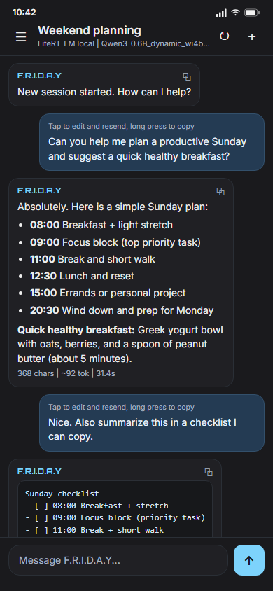
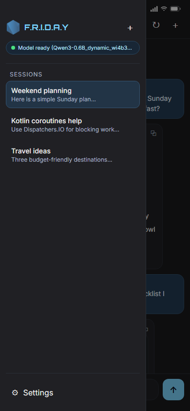
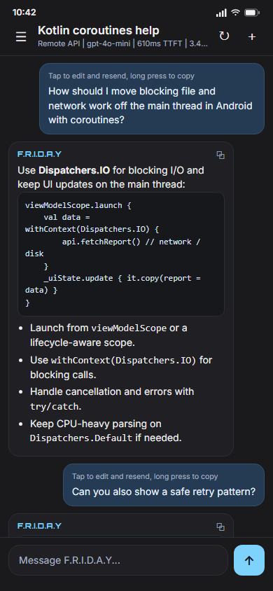
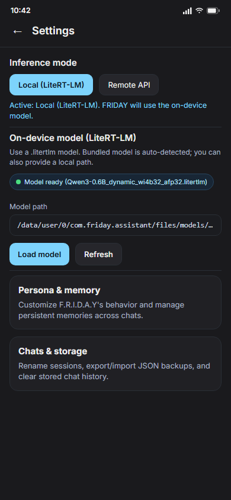

# F.R.I.D.A.Y

Local-first Android assistant app built with Kotlin and Jetpack Compose.

**Repository:** https://github.com/Chandrasen74/friday  
**Current version:** v0.8.7 (versionCode 35, `com.friday.assistant`, minSdk 26, target/compile SDK 35)

## Description

F.R.I.D.A.Y is an on-device-first personal assistant for Android inspired by Tony Stark's AI. It supports local inference with LiteRT-LM (bundled Qwen3-0.6B model) and configurable remote API inference, with chat sessions stored locally on the device.

## Screenshots

| Chat | Sessions drawer | Conversation | Settings |
| --- | --- | --- | --- |
|  |  |  |  |

An interactive HTML demo is available at [friday-demo.html](friday-demo.html) (open in a browser, use `?view=chat|drawer|chat2|settings|empty` to switch views).

## Features

- **Local inference (LiteRT-LM):** on-device text generation using `com.google.ai.edge.litertlm:litertlm-android` with a bundled/preloaded `litert-community/Qwen3-0.6B` (`Qwen3-0.6B_dynamic_wi4b32_afp32.litertlm`, CPU-oriented) model.
- **Remote API inference:** configurable endpoint/key/model with mode switching (Local / Remote API), flexible endpoint handling (OpenAI-compatible, Ollama-style, and custom paths), and endpoint testing.
- **Chat experience:** streaming responses, markdown rendering, stop generation, regenerate, edit and resend, copy messages, and generation metrics (TTFT, total time, estimated tokens/sec, chars/sec, output stats).
- **Sessions and storage:** local chat persistence (`filesDir`), create/select/delete sessions, rename sessions, clear current/all chats, and export/import chats as JSON.
- **Model manager:** view model status/path, list/refresh available models, download model by URL, load/unload/switch local model.
- **UI:** edge-to-edge/status and display-cutout aware layout, drawer navigation, settings and separate Chats & storage screens, splash/branding with F.R.I.D.A.Y identity.

## Tech stack

- **Language:** Kotlin
- **UI:** Jetpack Compose, Material 3
- **Build:** Gradle Kotlin DSL, Android Gradle Plugin 8.7.2, Kotlin 2.2.0 (Compose plugin), Gradle Wrapper 8.9
- **Android:** minSdk 26, targetSdk/compileSdk 35, Java/Kotlin JVM target 17

## Packages and dependencies

From `app/build.gradle.kts`:

- `androidx.core:core-ktx:1.15.0`
- `androidx.core:core-splashscreen:1.0.1`
- `androidx.lifecycle:lifecycle-runtime-ktx:2.8.7`
- `androidx.lifecycle:lifecycle-runtime-compose:2.8.7`
- `androidx.lifecycle:lifecycle-viewmodel-compose:2.8.7`
- `androidx.activity:activity-compose:1.9.3`
- `org.jetbrains.kotlinx:kotlinx-coroutines-android:1.7.3` (forced/pinned to 1.7.3 via resolution strategy)
- `androidx.compose:compose-bom:2024.10.01`
  - `androidx.compose.ui:ui`
  - `androidx.compose.ui:ui-graphics`
  - `androidx.compose.ui:ui-tooling-preview`
  - `androidx.compose.material3:material3`
  - `androidx.compose.material:material-icons-extended`
- `com.google.ai.edge.litertlm:litertlm-android:0.16.1` (on-device LiteRT-LM inference)
- `com.mikepenz:multiplatform-markdown-renderer-m3:0.27.0` (markdown rendering)
- Debug: `androidx.compose.ui:ui-tooling`, `androidx.compose.ui:ui-test-manifest`

## Build and install

### Prerequisites
- JDK 17
- Android SDK (API 35 platform/build tools)
- Android device or emulator (Android 8.0 / API 26+)

### Build debug APK
```bash
# Windows
.\gradlew.bat assembleDebug

# macOS/Linux
./gradlew assembleDebug
```

APK output: `app/build/outputs/apk/debug/app-debug.apk`

### Install via adb
```bash
adb install -r app/build/outputs/apk/debug/app-debug.apk
```

Prebuilt debug APKs are also published in [GitHub Releases](https://github.com/Chandrasen74/friday/releases).

## Tested on

Primary test device: **Samsung Galaxy M15 (SM-M156B)**, Exynos 1330, Android 15 (One UI 6), 4 GB RAM.

- Local `Qwen3-0.6B` (4-bit `.litertlm`) inference runs fully offline on CPU: streaming at roughly 2-3 tokens/s, with the first token taking longer on the initial prompt of a session (prefill is CPU-bound).
- Remote API mode streams much faster and is recommended for longer or higher-quality conversations.
- Verified on this device: local and remote streaming, markdown rendering, generation metrics, session management, persona and persistent memories, export/import, mode switching, model manager, portrait and landscape layouts, drawer navigation, and edge-to-edge/cutout behavior.

## Notes

- Local inference runs entirely on-device and is CPU-bound; response speed and quality depend on the selected local model and hardware (see Tested on).
- Remote API mode can be used for higher-quality responses by configuring a compatible endpoint.
- API credentials/config are stored in app preferences (API prefs excluded from Android backup rules); treat device security accordingly.

## License

All Rights Reserved

Copyright (c) 2026 Chandrasen. All rights reserved.

See [LICENSE](LICENSE).
