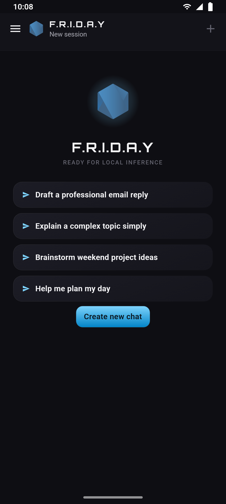
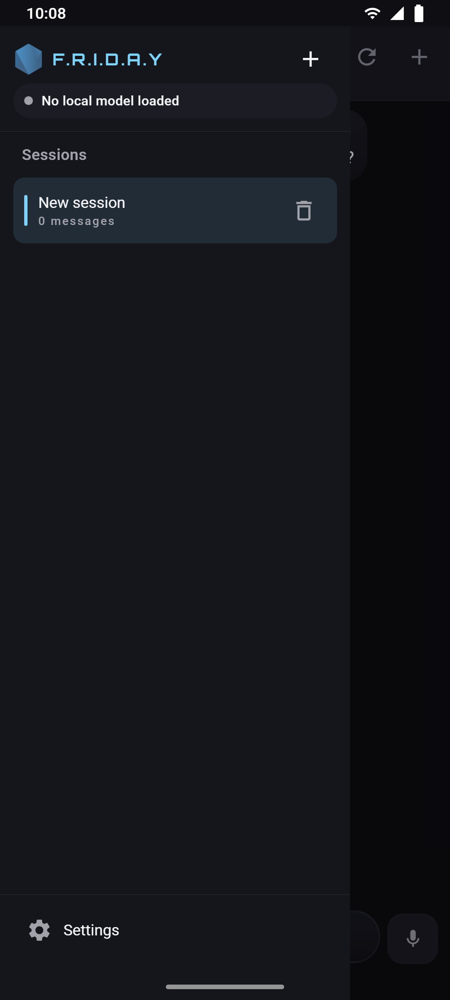
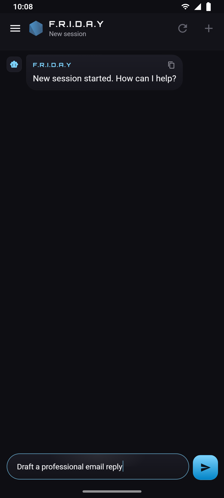
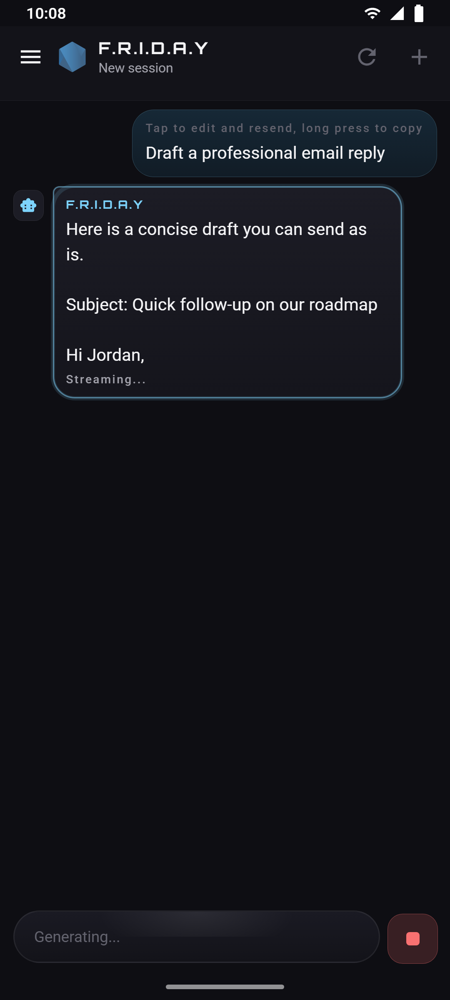
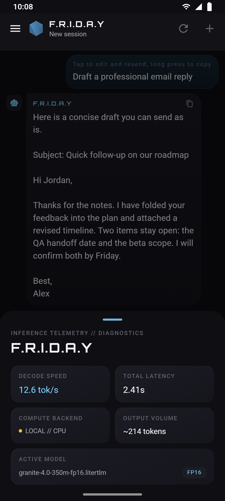
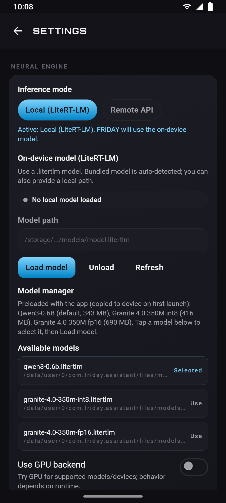

<p align="center">
  
</p>

<h1 align="center">F.R.I.D.A.Y</h1>

<p align="center">Local-first Android assistant app built with Kotlin and Jetpack Compose.</p>

<p align="center">
  <a href="https://github.com/Chandrasen74/friday/releases/tag/v0.9.0"></a>
  <a href="LICENSE"></a>
  
</p>

**Repository:** https://github.com/Chandrasen74/friday  
**Current source version:** v0.9.2 (versionCode 38, `com.friday.assistant`, minSdk 26, target/compile SDK 35)  
**Latest published release:** v0.9.0 (APK download below)

## Download

<p align="left">
  <a href="https://github.com/Chandrasen74/friday/releases/download/v0.9.0/friday-v0.9.0-debug.apk"></a>
  <a href="https://github.com/Chandrasen74/friday/releases"></a>
</p>

The APK is large because it bundles Qwen3-0.6B and Granite 4.0 350M (int8 and fp16). No model download is required after install.

## Description

F.R.I.D.A.Y is an on-device-first personal assistant for Android inspired by Tony Stark's AI. It supports local inference with LiteRT-LM (bundled Qwen3-0.6B model) and configurable remote API inference, with chat sessions stored locally on the device.

## Demo reel

[](pieces/friday-v092-demo/renders/final.mp4)

52s phone-first product film, 1080x1920 at 30 fps. [Watch the full video](pieces/friday-v092-demo/renders/final.mp4) or open the [piece docs](pieces/friday-v092-demo/) for screenshots, review sheets, and build notes.

## Screenshots

Real app UI used in the reel, captured at 1080x2400.

| Home | Models | Compose |
| --- | --- | --- |
|  |  |  |

| Streaming reply | Telemetry HUD | Settings |
| --- | --- | --- |
|  |  |  |

More frames and review sheets in the [demo reel docs](pieces/friday-v092-demo/).

## Features

- **Local inference (LiteRT-LM):** on-device text generation using `com.google.ai.edge.litertlm:litertlm-android` with preloaded models bundled in the APK: `litert-community/Qwen3-0.6B` (`Qwen3-0.6B_dynamic_wi4b32_afp32.litertlm`, default, CPU-oriented) plus `litert-community/granite-4.0-h-350m` int8 and fp16 variants. Models are copied to device storage on first launch.
- **Remote API inference:** configurable endpoint/key/model with mode switching (Local / Remote API), flexible endpoint handling (OpenAI-compatible, Ollama-style, and custom paths), and endpoint testing.
- **Chat experience:** streaming responses, markdown rendering, stop generation, regenerate, edit and resend, copy messages, and generation metrics (TTFT, total time, estimated tokens/sec, chars/sec, output stats) shown live in the status line while streaming.
- **Voice input:** microphone button composes prompts with on-device speech recognition, with a toast fallback when no speech service is available.
- **Spoken replies (TTS):** optional "Speak replies" setting reads assistant responses aloud; each reply has a speaker toggle to play or stop it.
- **Sessions and storage:** local chat persistence (`filesDir`), create/select/delete sessions, rename sessions, clear current/all chats, and export/import chats as JSON.
- **Model manager:** Qwen3-0.6B and Granite 4.0 350M (int8, fp16) are preloaded in the app for offline use; you can view model status/path, list/refresh available models, and load/unload/switch between them or load another local `.litertlm` by path.
- **Diagnostics:** in-app card with device, OS, ABI, app version, inference mode, model, last model-load and generation times, session/message counts, and TTS status, plus one-tap copy.
- **UI:** edge-to-edge/status and display-cutout aware layout, drawer navigation, settings and separate Chats & storage screens, splash/branding with F.R.I.D.A.Y identity.

## Tech stack

- **Language:** Kotlin
- **UI:** Jetpack Compose, Material 3
- **Build:** Gradle Kotlin DSL, Android Gradle Plugin 8.7.2, Kotlin 2.2.0 (Compose plugin), Gradle Wrapper 8.9
- **Android:** minSdk 26, targetSdk/compileSdk 35, Java/Kotlin JVM target 17

## Packages and dependencies

From `app/build.gradle.kts`:

- `androidx.core:core-ktx:1.15.0`
- `androidx.core:core-splashscreen:1.0.1`
- `androidx.lifecycle:lifecycle-runtime-ktx:2.8.7`
- `androidx.lifecycle:lifecycle-runtime-compose:2.8.7`
- `androidx.lifecycle:lifecycle-viewmodel-compose:2.8.7`
- `androidx.activity:activity-compose:1.9.3`
- `org.jetbrains.kotlinx:kotlinx-coroutines-android:1.7.3` (forced/pinned to 1.7.3 via resolution strategy)
- `androidx.compose:compose-bom:2024.10.01`
  - `androidx.compose.ui:ui`
  - `androidx.compose.ui:ui-graphics`
  - `androidx.compose.ui:ui-tooling-preview`
  - `androidx.compose.material3:material3`
  - `androidx.compose.material:material-icons-extended`
- `com.google.ai.edge.litertlm:litertlm-android:0.16.1` (on-device LiteRT-LM inference)
- `com.mikepenz:multiplatform-markdown-renderer-m3:0.27.0` (markdown rendering)
- Debug: `androidx.compose.ui:ui-tooling`, `androidx.compose.ui:ui-test-manifest`

## Requirements and first launch

- **Device:** Android 8.0+ (API 26+). Local inference is CPU-bound; performance depends on your hardware.
- **Storage:** the v0.9.0 APK is ~1.5 GB. On first launch the app copies ~1.1 GB of bundled models into device storage, so allow roughly 2.6 GB of free space (install plus copied models) before opening.
- **First launch:** the initial open can take several minutes and may appear unresponsive while bundled models are copied. This only happens once; subsequent launches are normal.
- **Microphone (optional):** voice input uses on-device speech recognition and requests microphone access when used.
- **Speech output (optional):** spoken replies use the device text-to-speech engine; availability and voice quality depend on installed TTS services.
- **Network (optional):** not required for local inference. Only needed for Remote API mode or if you configure an external endpoint.

## Build and install

### Prerequisites
- JDK 17
- Android SDK (API 35 platform/build tools)
- Android device or emulator (Android 8.0 / API 26+)

### Build debug APK
```bash
# Windows
.\gradlew.bat assembleDebug

# macOS/Linux
./gradlew assembleDebug
```

APK output: `app/build/outputs/apk/debug/app-debug.apk`

### Install via adb
```bash
adb install -r app/build/outputs/apk/debug/app-debug.apk
```

For a ready-to-install build, use the [Download](#download) section above.

## Tested on

Primary test device: **Samsung Galaxy M15 (SM-M156B)**, Exynos 1330, Android 16 (API 36), 4 GB RAM.

- Local `Qwen3-0.6B` (4-bit `.litertlm`) inference runs fully offline on CPU: streaming at roughly 2-3 tokens/s, with the first token taking longer on the initial prompt of a session (prefill is CPU-bound).
- Remote API mode streams much faster and is recommended for longer or higher-quality conversations.
- Verified on this device: local and remote streaming with the preloaded model, markdown rendering, live generation metrics (TTFT and tokens/sec in the status line), voice input, spoken replies with mute, diagnostics card, session management, persona and persistent memories, export/import, mode switching, model manager, portrait and landscape layouts, drawer navigation, and edge-to-edge/cutout behavior.

## Status

Updated: 2026-11-25

- **Security remediation (landed on `main`):** F-1 through F-4 from the `friday-test-1-a1e22fc` audit are remediated in code (HTTPS-only endpoint policy, credential origin binding, bounded response parsing, and pending approval for remote-extracted memories). 44 JVM unit tests pass across 5 suites via `:app:testDebugUnitTest`.
- **Device validation (in progress):** Samsung Galaxy M15 (SM-M156B, Android 16) pass started. L-7 per-message copy and L-8 full export copy showed the expected primary-clipboard sink with logcat evidence; L-10 TTS dispatch was observed partially (Google TTS path on device). L-1 through L-6, L-9, L-11, and L-12 through L-16 remain pending device/OEM evidence.
- **Emulator smoke (AOSP API 34, x86_64):** Install/launch, first-launch model copy, L-7 clipboard round-trip, and L-12 markdown custom-scheme dispatch to a dummy handler were confirmed. Emulator results are not representative for Samsung One UI clipboard/TTS/recognizer/backup behavior.

## Notes

- Local inference runs entirely on-device and is CPU-bound; response speed and quality depend on the selected local model and hardware (see Tested on). Bundled models: Qwen3-0.6B (default), Granite 4.0 350M int8, Granite 4.0 350M fp16.
- Remote API mode can be used for higher-quality responses by configuring a compatible endpoint.
- API credentials/config are stored in app preferences (API prefs excluded from Android backup rules); treat device security accordingly.

## License

All Rights Reserved

Copyright (c) 2026 Chandrasen. All rights reserved.

See [LICENSE](LICENSE).
