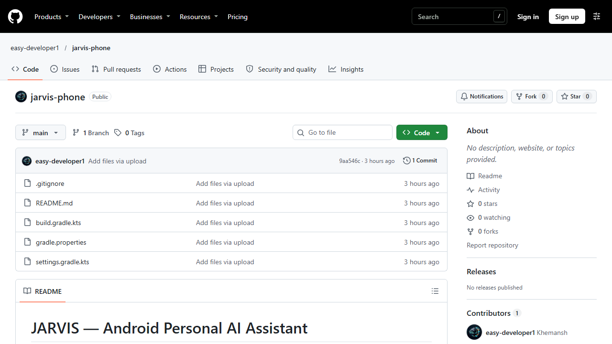

# FRIDAY

**Repository (local, prepared):** `REPO_ROOT`  
**Upstream reference:** https://github.com/easy-developer1/jarvis-phone



## Overview
FRIDAY is a local-first Android personal assistant project (Kotlin + Jetpack Compose), bootstrapped from the `jarvis-phone` concept and prepared as a clean, buildable baseline. It is named after Tony Stark's AI (F.R.I.D.A.Y.) and is intended to grow into a voice-capable on-device assistant.

- **Primary language:** Kotlin
- **Languages detected:** Kotlin, XML, Gradle Kotlin DSL
- **Stack/tech:** Android SDK, Jetpack Compose, Material 3, Gradle (AGP 8.7.2, Kotlin 2.0.21)
- **Entry point:** `app/src/main/java/com/friday/assistant/MainActivity.kt`
- **Current state:** baseline scaffold in place (app module, wrapper, CI workflow file, hygiene/docs). Core assistant features are planned, not yet implemented.

## Language & stack details
- **Android:** minSdk 26, target/compile SDK 35, applicationId `com.friday.assistant`
- **UI:** Jetpack Compose (Material 3), edge-to-edge Compose activity shell
- **Build:** Gradle Kotlin DSL, Gradle wrapper (8.9), Android Gradle Plugin 8.7.2, Kotlin 2.0.21 with Compose plugin
- **CI (ready):** GitHub Actions workflow at `.github/workflows/build-apk.yml` to assemble and upload a debug APK (when pushed to a remote)

## Status and roadmap

### Implemented in this baseline
- [x] Buildable Android project structure (`:app` module, manifest, resources, Compose entry point)
- [x] Gradle wrapper and root/app Gradle configuration
- [x] Basic FRIDAY UI shell (welcome/status screen)
- [x] Debug APK CI workflow definition (local file)
- [x] Repository hygiene: proprietary license, improved `.gitignore`, `.gitattributes`, `.editorconfig`, contributing guide, issue/PR templates

### Planned (not yet implemented)
- [ ] System speech-to-text (push-to-talk and wake flow) and text-to-speech
- [ ] Wake-word foreground service ("Hey FRIDAY") with visible notification
- [ ] Local Room database for conversations, messages, memories, reminders
- [ ] Long-term memory UI and memory-aware responses
- [ ] OpenAI-compatible online AI client with encrypted API key storage
- [ ] Local intent/fallback replies (time, reminders, app/web intents, basic commands)
- [ ] Optional on-device generative model (MediaPipe/LiteRT Gemma task)
- [ ] Optional integrations (Gmail/Contacts/Calendar) behind proper OAuth and least-privilege scopes

> Note: The upstream README described these features as implemented. In this repository they are treated as roadmap items until code lands and is verified.

## How to install & run

### Prerequisites
- JDK 17
- Android SDK (API 35 platform/build tools) and/or Android Studio
- An Android device or emulator (Android 8.0 / API 26+)

### Build locally
```bash
git clone <your-remote-url>/friday.git
cd friday

# Build debug APK (Windows)
gradlew.bat assembleDebug

# Build debug APK (macOS/Linux)
./gradlew assembleDebug

# APK output:
# app/build/outputs/apk/debug/app-debug.apk
```

You can also open the project in Android Studio and run the `app` configuration on a device/emulator.

### CI (when published to GitHub)
- Workflow: `.github/workflows/build-apk.yml`
- Trigger: manual (`workflow_dispatch`) or push to `main`
- Artifact: `friday-debug-apk` (debug APK)

## Repository structure (top-level)
- `app/` - Android application module (Compose UI, manifest, resources)
- `gradle/wrapper/` - Gradle wrapper (8.9)
- `.github/` - CI workflow and issue/PR templates
- `build.gradle.kts`, `settings.gradle.kts`, `gradle.properties` - Gradle build configuration
- `LICENSE`, `CONTRIBUTING.md`, `.editorconfig`, `.gitattributes`, `.gitignore`
- `README.md`, `screenshot.png`

## Privacy and security notes (planned behavior)
- No hardcoded API keys or secrets in source.
- Intended design: local-first data, encrypted storage for remote API credentials, visible microphone/notification state, and least-privilege integrations.
- Do not store passwords or highly sensitive secrets in assistant memory notes.

## Status
Baseline scaffold prepared locally with Chandrasen-style repository hygiene and honest documentation. Feature implementation, device testing, and real app screenshots are follow-on work.

## License

All Rights Reserved

Copyright (c) 2026 Chandrasen. All rights reserved.

This repository and its contents are proprietary. No permission is granted to use, copy, modify, merge, publish, distribute, sublicense, and/or sell copies of this software or its contents, in whole or in part, without prior written permission from the copyright holder. See [LICENSE](LICENSE).
