# FRIDAY v0.9.2 Demo Reel

Deterministic, phone-first product film for FRIDAY (com.friday.assistant), rebuilt from the [FRIDAY_shotlist.md](FRIDAY_shotlist.md) spec. The reel uses only real app UI captures with camera motion and drawn overlays, no invented chrome.

- **Format:** 1080x1920 (9:16), 30 fps, 52.0s, 1560 frames
- **Music:** A minor, 120 BPM, seeded procedural score + SFX (original, deterministic)
- **Style:** two typefaces (Orbitron display, Roboto UI), one accent `#38BDF8`, grounds `#09090C` / `#0E0E13` / `#15151C`
- **Structure:** 11 beats, exactly two structural full-frame moments: the HUD hard cut at **22.0s / frame 660** and the end-card lockup

## Final Video

<a href="renders/final.mp4">
  
</a>

- [Play / download final.mp4](renders/final.mp4) (click the preview above, or use this link; GitHub does not inline-play repo videos in README pages)
- [Poster frame](renders/poster.png)
- [Audio master (WAV)](renders/audio.wav) | [Music stem](renders/stem-music.wav) | [SFX stem](renders/stem-sfx.wav)

## Updated Screenshots

### Final poster

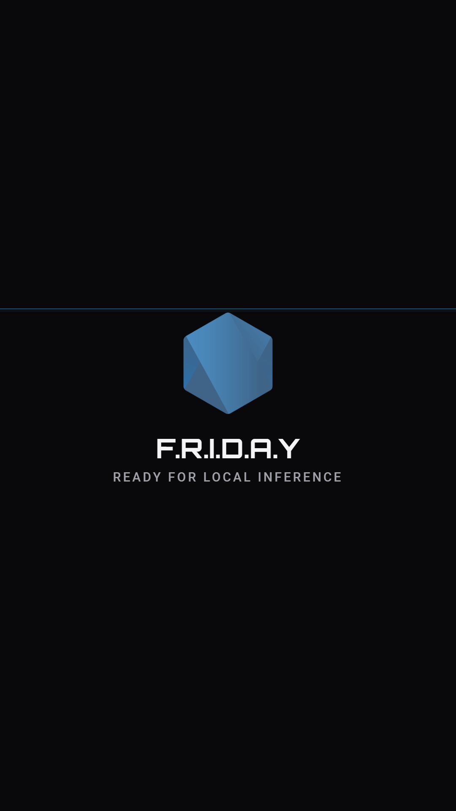

### Final contact sheet

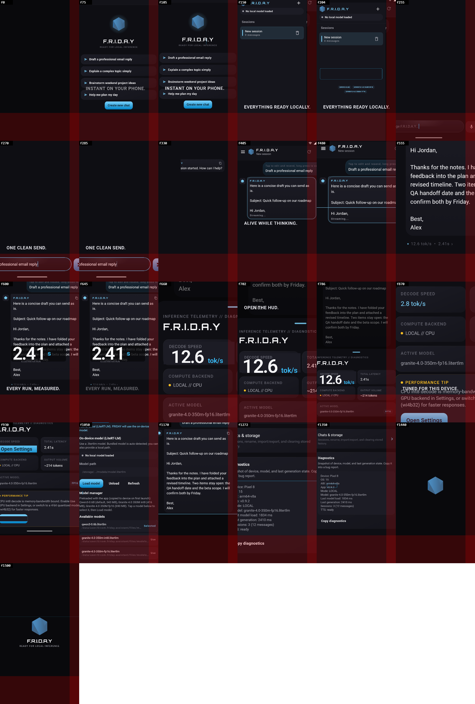

### Phone review sheet

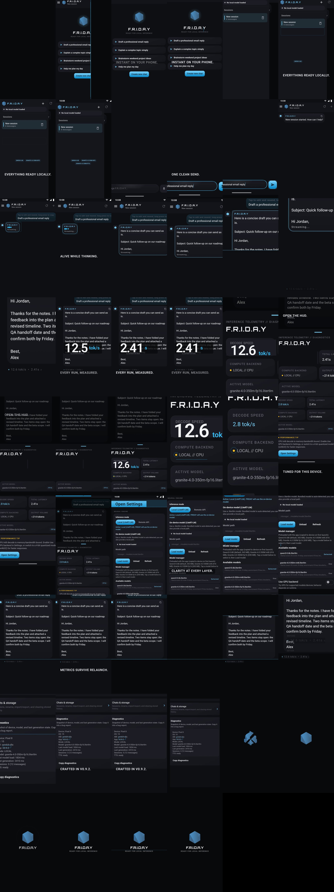

### Per-shot review sheets

| Beat | Time | Caption / focus | Sheet |
| --- | --- | --- | --- |
| 1 | 0-4s | Instant on your phone. | 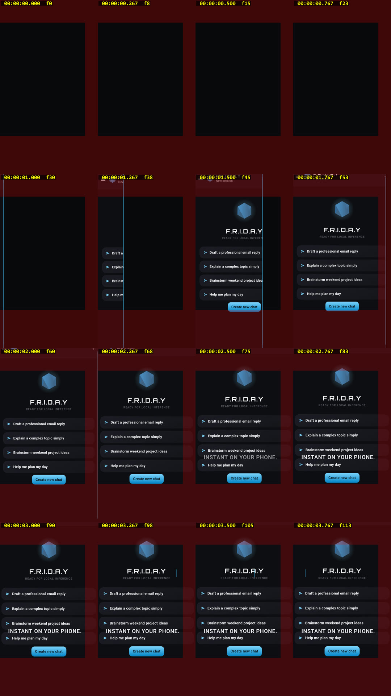 |
| 2 | 4-8s | Everything ready locally. | 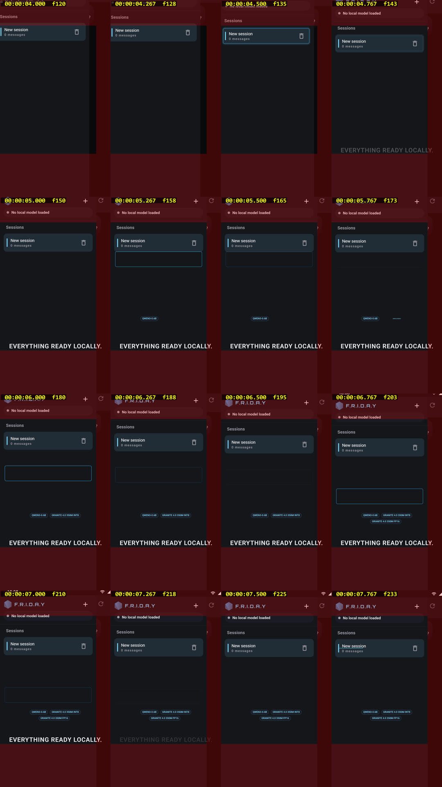 |
| 3 | 8-12s | One clean send. | 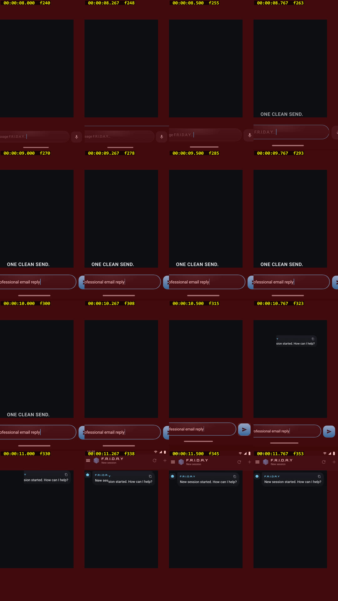 |
| 4 | 12-18s | Alive while thinking. | 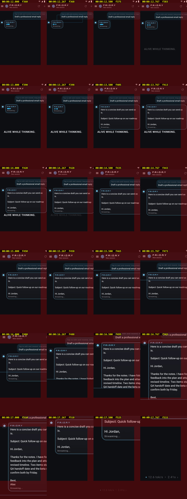 |
| 5 | 18-22s | Every run, measured. | 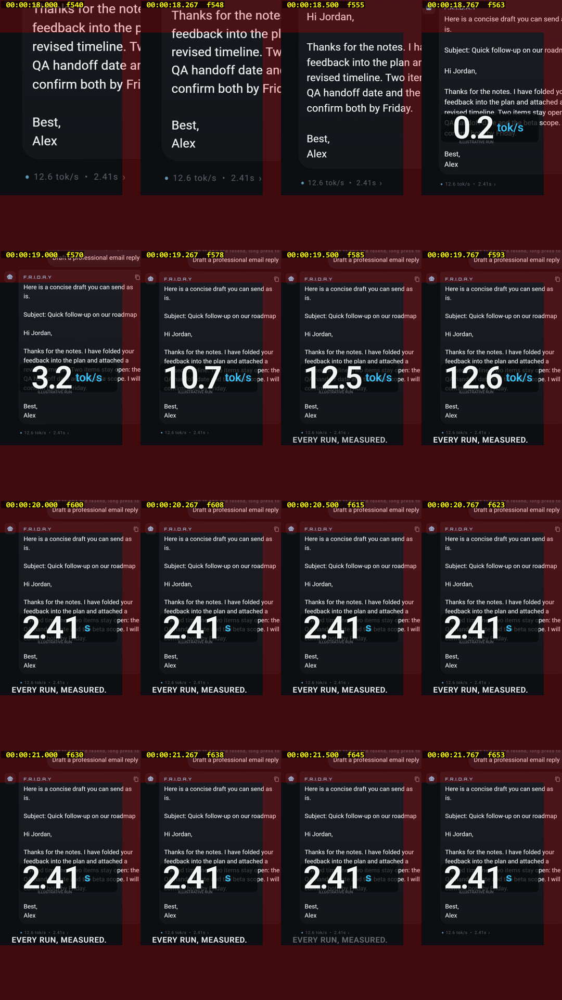 |
| 6 | 22-28s | Open the HUD. (hard cut at 22.0s) | 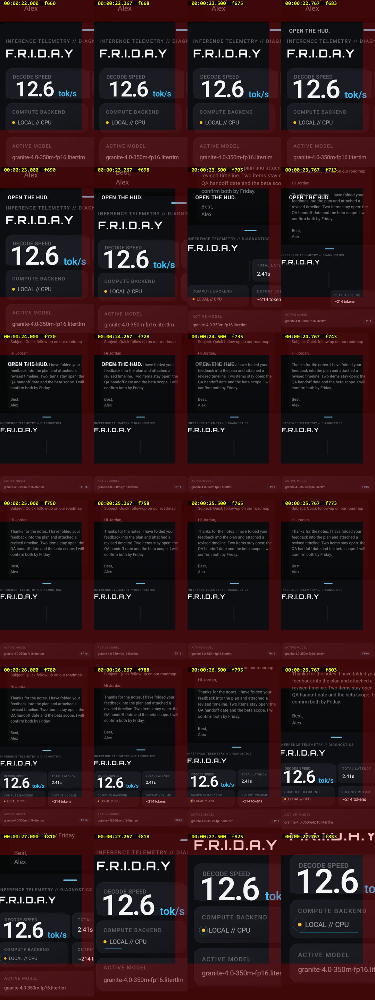 |
| 7 | 28-32s | Tuned for this device. | 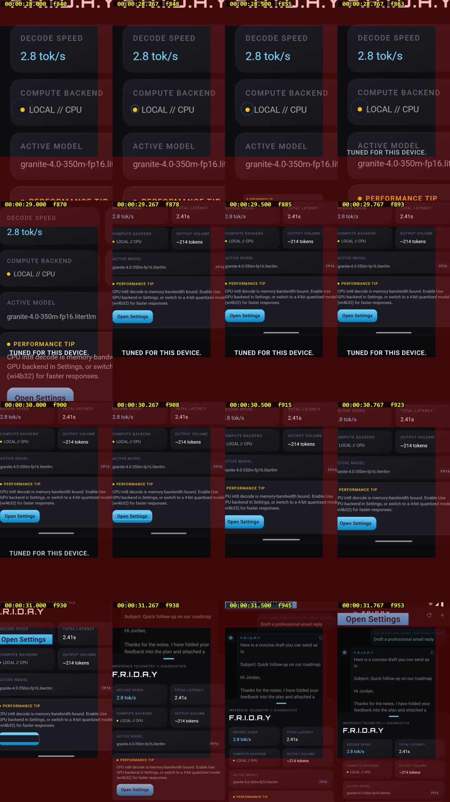 |
| 8 | 32-36s | Clarity at every layer. | 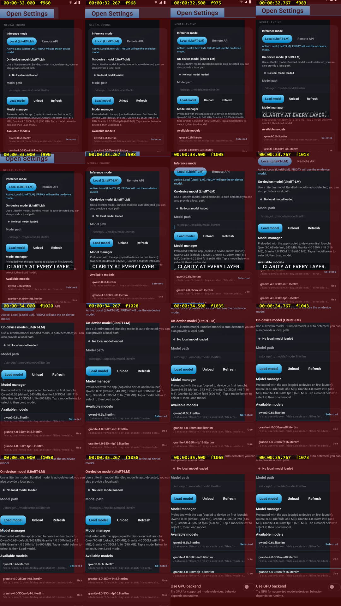 |
| 9 | 36-42s | Metrics survive relaunch. | 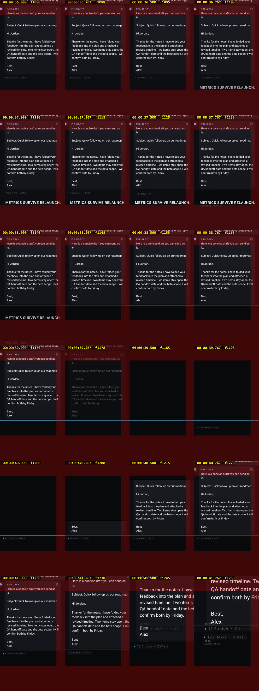 |
| 10 | 42-46s | Crafted in v0.9.2 | 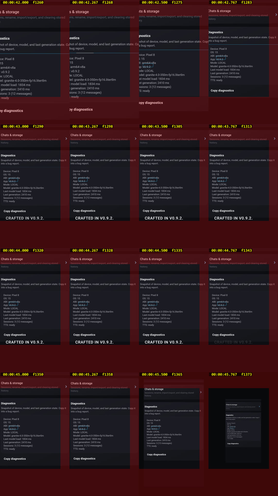 |
| 11 | 46-52s | Lockup / end card | 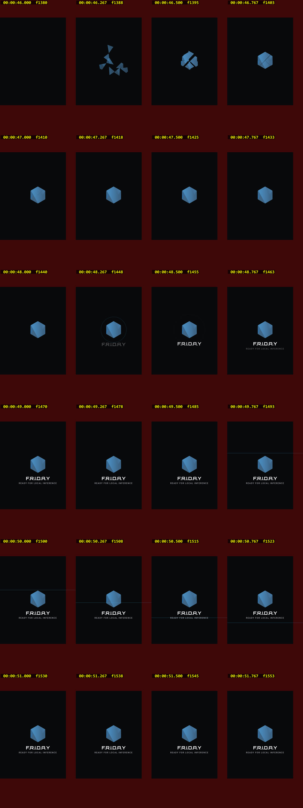 |

## Beat Summary

| # | Time | Shot | Caption | Notes |
| --- | --- | --- | --- | --- |
| 1 | 0-4 | Instant | Instant on your phone. | Facets/lockup, scan wipe into home |
| 2 | 4-8 | Ready locally | Everything ready locally. | Drawer rows, pings, model chips |
| 3 | 8-12 | One clean send | One clean send. | Carried line, border ignite, typed prompt, send |
| 4 | 12-18 | Alive while thinking | Alive while thinking. | Streaming reply progression |
| 5 | 18-22 | Every run, measured | Every run, measured. | Footer/hero counters, near-silence into the hit |
| 6 | 22-28 | Open the HUD | Open the HUD. | Hard cut at 22.0s, hero metrics, HUD reveal |
| 7 | 28-32 | Tuned for this device | Tuned for this device. | Tip card / settings match |
| 8 | 32-36 | Clarity at every layer | Clarity at every layer. | Settings list dolly and ticks |
| 9 | 36-42 | Metrics persist | Metrics survive relaunch. | Before/after relaunch continuity |
| 10 | 42-46 | Crafted in v0.9.2 | (version reveal) | Diagnostics / v0.9.2 push |
| 11 | 46-52 | Lockup | (end card) | Facets reassemble, hold to resolve |

## Quality and Verification

- **Critique loop:** 3 rounds in [FRIDAY_critique.md](FRIDAY_critique.md), stopped when every axis scored >= 8 (round 3: 9,9,9,9,9,9,8,8,9,9).
- **review.mjs (final build):** all 10 cuts on grid PASS; text PASS (0 cut-off/overlap); sound PASS (-15.5 LUFS integrated, true peak -1.0 dBFS, loudest 100ms window at 22.0s with 2.0s silence before). Story-arc FAIL and the end-card dead-hold WARN are accepted heuristic deviations (scripted loud resolve at 48.0s; sanctioned end-card hold).
- **ffprobe:** h264, yuv420p, 1080x1920, 30/1, duration 52.000000s (video+audio).
- **Audio arc (decoded):** near-silence 20.2-21.8s ~ -47.3 dB RMS; loudest hit 21.95-22.25s ~ -7.79 dB RMS / -0.94 dBFS peak; scripted resolve 47.9-48.3s ~ -8.79 dB RMS; tail ~ -82.6 dB RMS.
- Full details, commands, and accepted deviations: [renders/qc_report.md](renders/qc_report.md). Build/review log and all deviations: [LOG.md](LOG.md).

## Source of Truth

- Editable source: `src/head.html`, `src/scenes.js`, `src/scenes2.js`, `src/bridges.js`, `src/score.js`, `src/override.js`
- Build config: `piece.json` (build list, format, review safe areas)
- Timeline/shot intent: [FRIDAY_shotlist.md](FRIDAY_shotlist.md), `storyboard.md`, `storyboard.png`
- Product captures and geometry inputs: `assets/shots/`, `assets/screen_map.md`
- Built output: `index.html`

## Build and Export

From the piece root:

```powershell
# Build
node "C:\Users\Kanchan Verma\.config\opencode\skills\creative\animate\tools\build.mjs" "C:\Users\Kanchan Verma\OneDrive\Desktop\Opencode\01-Projects\friday\pieces\friday-v092-demo"

# Full export (frames + audio/stems + renders/final.mp4)
node "C:\Users\Kanchan Verma\.config\opencode\skills\creative\animate\tools\export.mjs" "C:\Users\Kanchan Verma\OneDrive\Desktop\Opencode\01-Projects\friday\pieces\friday-v092-demo"

# Review gate (sheets + automated checks)
node "C:\Users\Kanchan Verma\.config\opencode\skills\creative\animate\tools\review.mjs" "C:\Users\Kanchan Verma\OneDrive\Desktop\Opencode\01-Projects\friday\pieces\friday-v092-demo"

# Single still (example: poster)
node "C:\Users\Kanchan Verma\.config\opencode\skills\creative\animate\tools\still.mjs" "C:\Users\Kanchan Verma\OneDrive\Desktop\Opencode\01-Projects\friday\pieces\friday-v092-demo" 50.0 "renders/poster.png"
```

`export.mjs` writes `renders/audio.wav` and stems from the in-piece score, encodes libx264 (crf 14, preset slow, yuv420p) + AAC, and muxes `renders/final.mp4`. Frame intermediates under `frames/` are regenerable and were removed after mux in the final pass.

## Notes

- `renders/share.mp4` is from the superseded 2026-11-17 pass (stale). Regenerate on demand if a current share encode is needed.
- `renders/baseline_draft_24fps/` is preserved.
- No human playback or by-ear audio review was performed; verification is deterministic render + automated review + pixel probes + audio-window measurements.
- Scope stayed in `pieces/friday-v092-demo/`; no app source/behavior, package identity, release metadata, APKs, signing, or production assets were changed.
